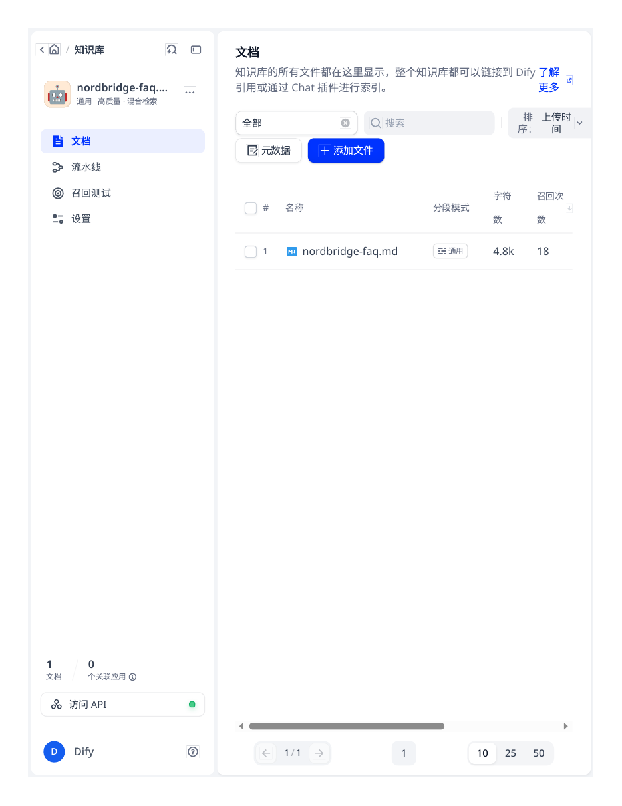
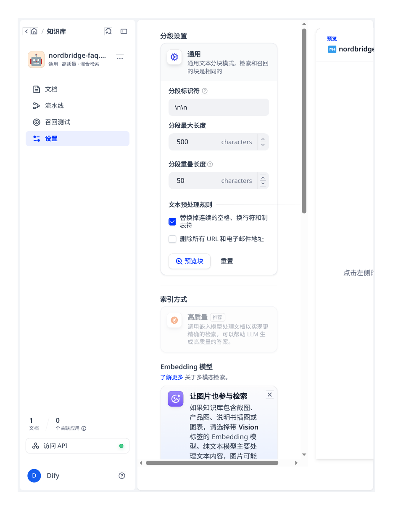
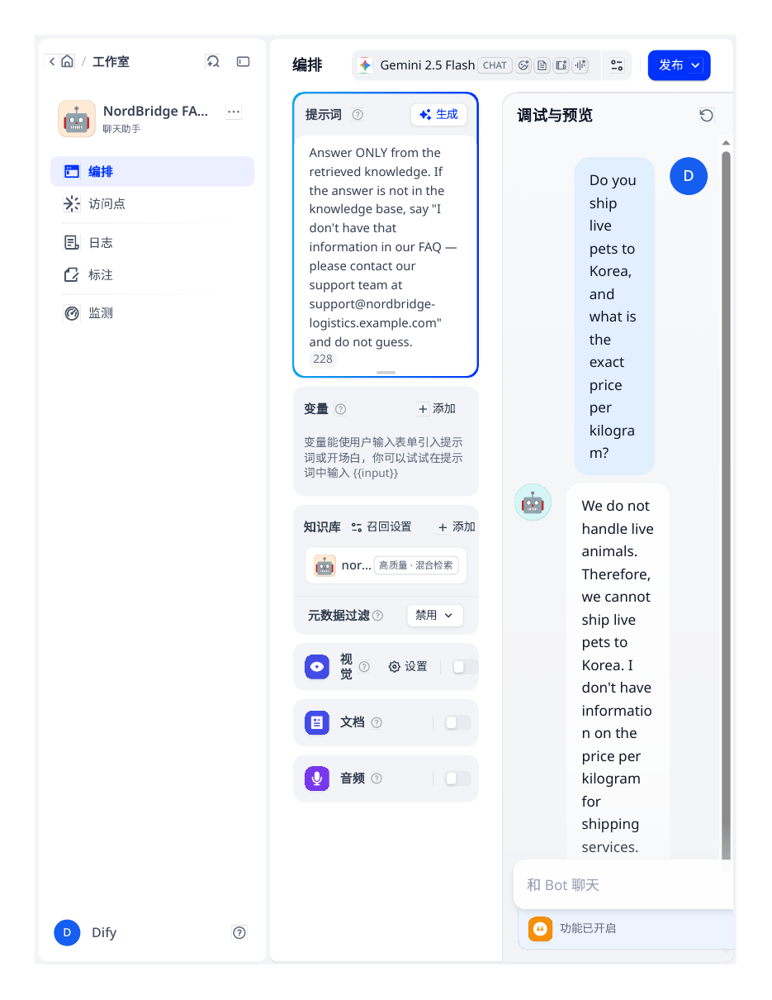
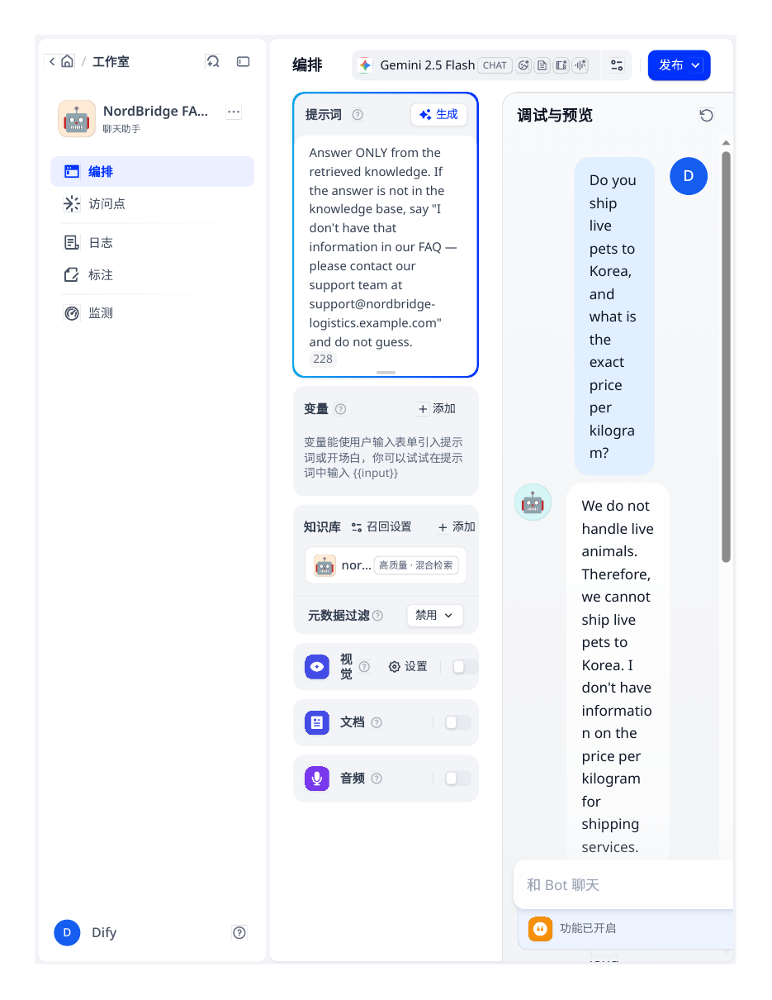
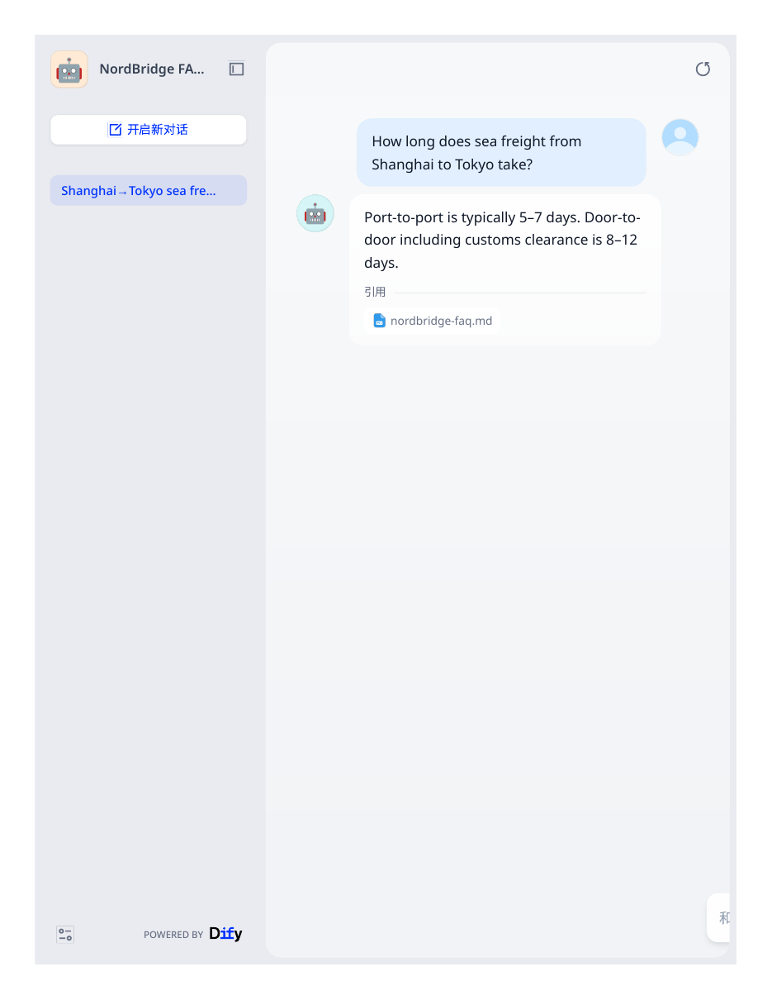

# NordBridge FAQ RAG Demo

A retrieval-augmented FAQ chatbot for a fictional China↔Japan freight forwarder, built with **Dify** + **Gemini**.

## What it does

- Answers customer questions strictly from the company's FAQ knowledge base (25 entries: quotes, customs, tracking, insurance, claims)
- Refuses to hallucinate: falls back to a human-handoff message when the answer is not in the knowledge base
- Hybrid search (vector + keyword) with top-K = 3 for better recall on part numbers and place names

## Stack

Dify (Cloud) · Gemini via Google AI Studio · Hybrid retrieval · Prompt-level grounding instruction

## Try it

**Live demo: https://udify.app/chat/KIlnt5DyLeQbNl2s** (no sign-in needed — ask it about shipping times, customs, insurance, or try to make it answer something outside the FAQ)

This repo contains the knowledge base (`knowledge/nordbridge-faq.md`) and screenshots (`screenshots/`). To rebuild: import the FAQ file into a Dify Knowledge base (chunk 500 / overlap 50), create a Chatbot, and add the grounding instruction from `prompt/system-instruction.txt`.

## Screenshots

Knowledge base — `nordbridge-faq.md` indexed and available:

Retrieval settings — hybrid search (semantic 0.7 / keyword 0.3), top K = 3:

App orchestration — grounding instruction + Gemini 2.5 Flash:

Preview test — correct grounded answers, and an honest "I don't have that information" instead of a hallucinated price:

The published web app answering live:

## What this proves

I can take a small business's messy docs and turn them into a working, hallucination-safe support bot in an afternoon — the same deliverable I ship to clients.
